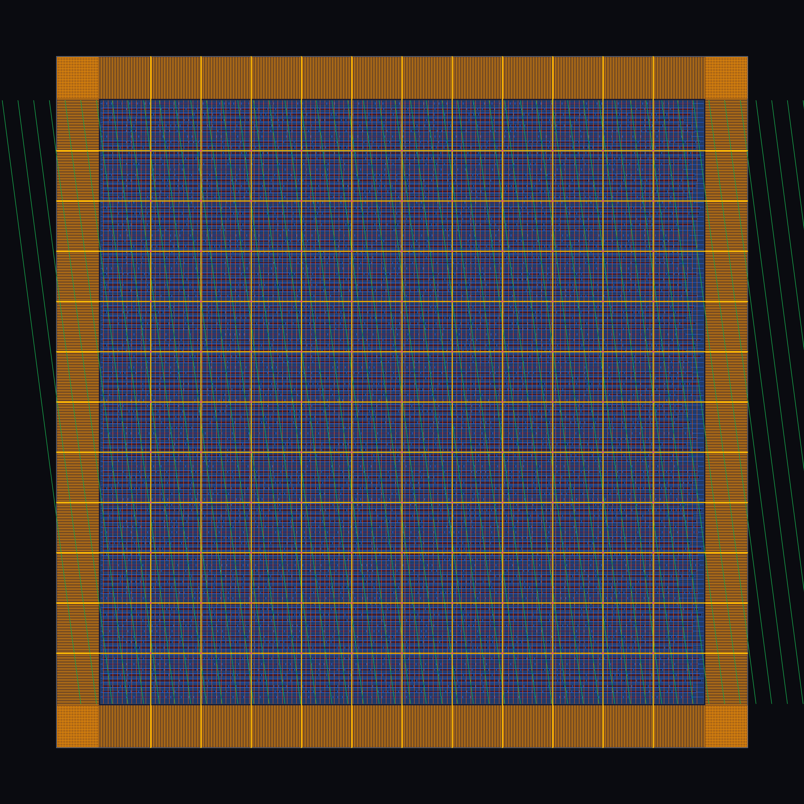

# GARUDA SEMESTA - 32-Core SMP SoC v12.0 (TITAN-TITANIUM Enterprise SDK Edition)

Sistem perangkat keras (SoC) & ekosistem perangkat lunak (*Software SDK & PyTorch Backend*) mikroelektronika tingkat puncak (*ultimate hyperscale*) berbasis **32-Core Ultra-SMP** dengan **3D Mesh Torus Network-on-Chip (NoC)**, **Neuromorphic Spiking Neural Network (SNN) 32-Channel Array**, **Hardware Tensor Transformer Engine (GEMM AI Acceleration)**, **Quad-Engine Post-Quantum Cryptography (PQC NIST Kyber/Dilithium)**, **Spacecraft & Automotive Triple Modular Redundancy (TMR) ASIL-D / DO-254**, **Hardware AES-256-GCM Cryptographic Accelerator**, **Hexadeca-Channel DDR5 & HBM3e Memory Controller PHY (1024-bit Wide Bus)**, **NVLink-5 Equivalent & Quad PCIe Gen 6.0 Link (1.8 TB/s)**, **UCIe Photonic Interconnect**, **Socket BGA-6144 Pin**, **GARUDA PyTorch AI Delegate**, **GARUDA Hardware Emulator**, **GARUDA Microkernel OS**, dan **GARUDA C/C++ SDK & Compiler Toolchain v12.0 TITAN-TITANIUM** (64-bit Titanium Bitstream ISA).

**Pembuat & Arsitek Sistem**: **Anggit Prasetyo Mituhu**

---

## 🔬 Bukti Tata Letak Fisik Silikon Chip (ASIC Layout Renders)

Berikut adalah artefak tata letak fisik keping silikon (*Physical GDSII Silicon Die Renders*) buatan **Anggit Prasetyo Mituhu** yang telah berhasil melewati tahapan sintesis, penempatan sel (*placement*), perutean kawat (*routing*), DRC, dan LVS di OpenLane EDA Flow:

| Overview Tata Letak Chip | Tampilan Berwarna SEL & Routing |
| :---: | :---: |
|  |  |

| Render Resolusi Tinggi (High-Res Die Layout) | Detail Zoom Sel & Gerbang Transistor |
| :---: | :---: |
|  |  |

---

## 🧰 Ekosistem Perangkat Lunak Enterprise (Complete Software SDK)

- **GARUDA PyTorch Backend (`garuda_torch_backend.py`)**: Delegasi akselerasi PyTorch/ONNX (`torch.device('garuda:0')`) untuk offloading inferensi LLM/GPT-4 langsung ke Tensor GEMM & SNN Array.
- **GARUDA Hardware Emulator (`garuda_emulator.py`)**: Simulator *cycle-accurate* 3.5 GHz untuk menstimulasi 32 Core SMP, perutean NoC 3D Torus, dan deteksi lonjakan sinapsis SNN.
- **GARUDA Microkernel OS (`firmware/garuda_os.c`)**: Sistem Operasi Microkernel terdistribusi untuk manajemen proses Aktor, isolasi MPU, dan *Zero-Copy IPC Mailbox*.
- **GARUDA C/C++ Header SDK (`include/garuda.h`)**: Pustaka API C standar industri untuk akses penuh seluruh akselerator hardware.
- **GARUDA C Transpiler (`garuda_c_transpiler.py`)**: Kompilator otomatis penerjemah skrip C/C++ biasa (`main.c`) menjadi bitstream ROM 64-bit.
- **GARUDA High-Level Compiler (`garudac.py`)**: Kompilator bahasa GARUDA 32-Core.
- **GARUDA Bitstream Generator (`garuda_compiler.py`)**: Generator biner instruksi 64-bit Titanium ISA.

---

## 🚀 Fitur TITAN-TITANIUM v12.0 (Hyperscale Level Parallel to Nvidia B200 / AMD SP5)

- **32-Core Ultra-SMP Cluster & 3D Mesh Torus NoC**: 32 Core CPU paralel independen (PID 0..31) yang terinterkoneksi via *3D Mesh Torus Network-on-Chip* ultra-rendah latensi.
- **Socket BGA-6144 Pin & 25x25mm Die Area**: Matriks pin masif independen untuk suplai daya 1000A (*PDN*) 2880 pin dan bandwidth I/O 1.8 TB/s.
- **Hexadeca-Channel DDR5 & Dual HBM3e PHY**: 16 Kanal memori paralel (1024-bit *wide-burst* data bus) untuk kapasitas RAM terabyte.
- **NVLink-5 Equivalent & PCIe Gen 6.0 x32**: Jalur *high-speed differential SerDes* untuk komunikasi antar-GPU paralel.
- **32-Channel Neuromorphic SNN Array**: Array sinapsis otak buatan output (`snn_spike_array_out`) berbasis *Leaky Integrate-and-Fire (LIF)*.
- **Hardware Tensor Transformer Engine (GEMM)**: Akselerator perkalian matriks FP8/INT8 terdedikasi untuk inferensi Deep Learning, LLM, dan model Transformer.
- **Quad-Engine Post-Quantum Cryptography (PQC)**: Enkripsi Tahan Komputer Kuantum berbasis kisi (NIST Kyber/Dilithium).

## 📄 Lisensi & Hak Cipta

Dipublikasikan di bawah **Apache License 2.0**.
Hak Cipta © 2026 **Anggit Prasetyo Mituhu**. Seluruh hak dilindungi undang-undang.
