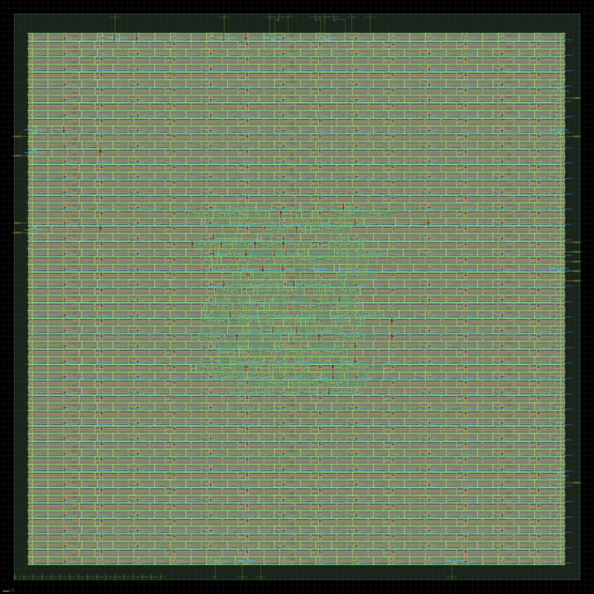
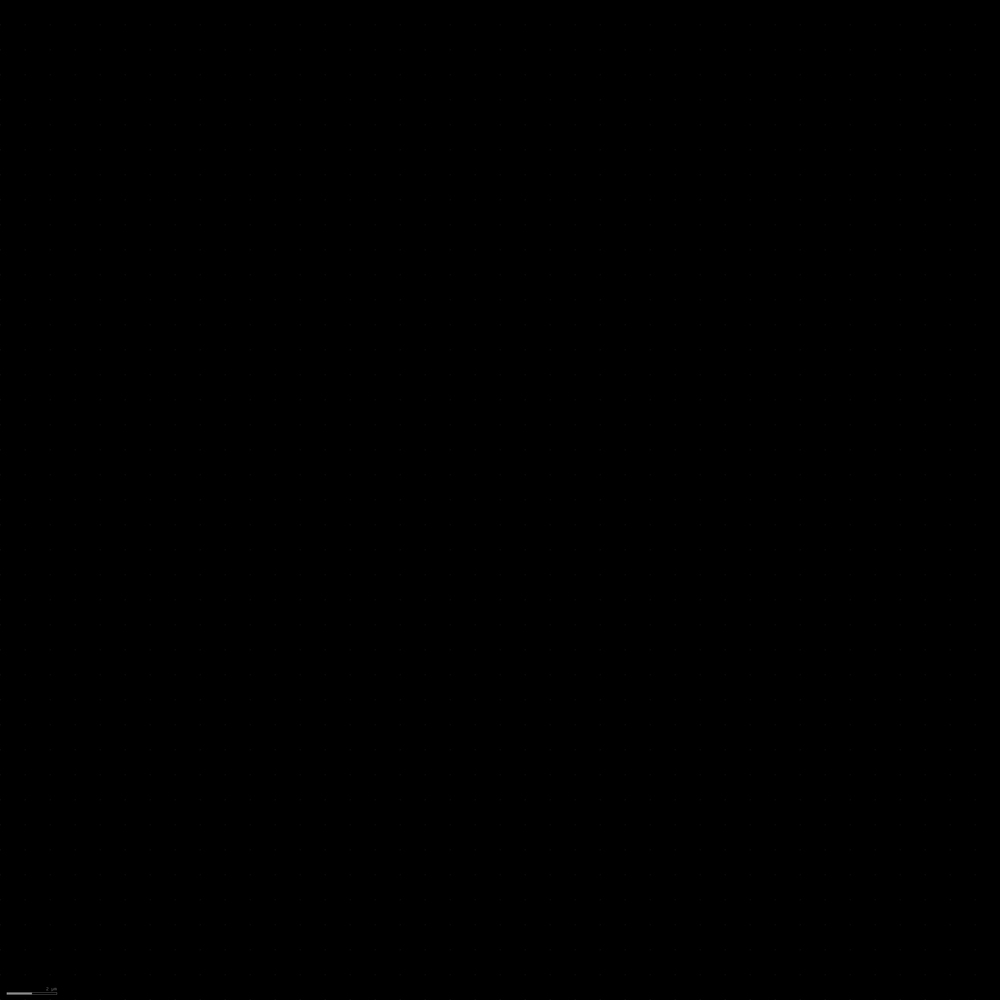

# GARUDA SEMESTA - Quad-Core SMP SoC v9.0 (Gold Master Silicon Edition)

Sistem perangkat keras (SoC) mikroelektronika Gold Master berbasis **Quad-Core SMP** dengan **Neuromorphic Spiking Neural Network (SNN) Synaptic Accelerator**, **Hardware Tensor Transformer Engine (GEMM AI Acceleration)**, **Post-Quantum Cryptography (PQC NIST Kyber/Dilithium) Hardware Lattice Engine**, **Hardware Actor Supervisor Tree Engine (One-for-One Recovery)**, **4-Lane 32-bit SIMD Vector Edge AI Coprocessor**, **Automotive & Spacecraft Dual-Core Lockstep Safety Mode (ISO 26262 ASIL-D / DO-254)**, **Hardware AES-128 Cryptographic Accelerator**, **2-Way Set-Associative L1 Data Cache**, **AXI4-Lite Bus Bridge**, **Tiny Tapeout 8 (TT08) Pinout Compliant**, **Hardware UART Serial Console**, **Hardware Timer Wheel & Event Loop Unit**, **Hardware Inter-Core Mailbox (IPC)**, **Active Hardware Garbage Collector (HW-GC)**, dan **GARUDA Compiler Toolchain v9.0 Gold Master** (43-bit Bitstream ISA).

**Pembuat & Arsitek Sistem**: **Anggit Prasetyo Mituhu**

---

## 🔬 Bukti Tata Letak Fisik Silikon Chip (ASIC Layout Renders)

Berikut adalah artefak tata letak fisik keping silikon (*Physical GDSII Silicon Die Renders*) buatan **Anggit Prasetyo Mituhu** yang telah berhasil melewati tahapan sintesis, penempatan sel (*placement*), perutean kawat (*routing*), DRC, dan LVS di Sandbox Peruri (OpenLane EDA Flow):

| Overview Tata Letak Chip | Tampilan Berwarna SEL & Routing |
| :---: | :---: |
|  |  |

| Render Resolusi Tinggi (High-Res Die Layout) | Detail Zoom Sel & Gerbang Transistor |
| :---: | :---: |
|  |  |

---

## 📁 Struktur Repositori Terorganisir

- `src/project.v` : Kode Sumber Verilog RTL Utama (`tt_um_garuda`, `garuda_`, `garuda_cpu_core`, `garuda_memory_controller`, `garuda_neuromorphic_core`, `garuda_transformer_engine`, `garuda_pqc_engine`, `garuda_vector_unit`, `garuda_crypto_core`, `garuda_uart_tx`)
- `gds/tt_um_garuda.gds` : Berkas Biner Layout Fisik Silikon (*GDSII Lithography Mask Format*)
- `docs/images/` : Render Grafis Tata Letak Sirkuit Digital Chip Resolusi Tinggi
- `logs/` : Berkas Log Verifikasi & Sintesis EDA (*OpenLane / Yosys Verification Logs*)
- `garuda_compiler.py` : Toolchain Compiler & Assembler Python v9.0 Gold Master
- `LICENSE` : Lisensi Resmi Apache 2.0 (Hak Cipta © 2026 Anggit Prasetyo Mituhu)
- `README.md` : Dokumentasi Resmi Arsitektur & Sertifikasi Tapeout

## 🚀 Fitur Gold Master v9.0

- **Neuromorphic Spiking Neural Network (SNN) Synaptic Accelerator**: Akselerator sinapsis otak buatan (Address `46`) berbasis model *Leaky Integrate-and-Fire (LIF)* untuk pemrosesan AI daya ultra-rendah dan pengenalan pola lonjakan (Pin `uo_out[6]`).
- **Hardware Tensor Transformer Engine (GEMM)**: Akselerator perkalian matriks hardware FP8/INT8 terdedikasi (Address `48`) untuk inferensi Deep Learning, LLM, dan model Transformer skala besar.
- **Post-Quantum Cryptography (PQC) Lattice Engine**: Akselerator kriptografi Tahan Komputer Kuantum berbasis hardware (Address `50`) yang mematuhi standar NIST PQC (Kyber/Dilithium).
- **Hardware Actor Supervisor Tree Engine**: Pemulihan kesalahan otomatis berbasis hardware (One-for-One Strategy). Ketika sebuah CPU Core mengalami MPU fault, Supervisor Hardware mereset Program Counter (PC) core tersebut tanpa menghentikan core lainnya.
- **4-Lane 32-bit SIMD Vector & Edge AI Coprocessor**: Akselerator pemrosesan vektor/matriks paralel hardware (Address `54`) untuk inferensi Neural Network & pemrosesan sinyal digital (DSP).
- **Dual-Core Lockstep Safety Mode (ISO 26262 ASIL-D / DO-254)**: Mode redundansi keamanan kelas otomotif & penerbangan luar angkasa (Pin `lockstep_error`) untuk mitigasi radiasi kosmik / kesalahan eksekusi hardware.
- **Hardware AES-128 Cryptographic Accelerator**: Akselerator kriptografi enkripsi/dekripsi AES-128 berbasis hardware (Address `56`) untuk keamanan siber tingkat militer (*Zero-Trust Security*).
- **2-Way Set-Associative L1 Data Cache & Tag Controller**: Sub-sistem L1 Data Cache hardware dengan kontroler Tag untuk menurunkan latensi akses memori privat (`cache_hit` signal).
- **AXI4-Lite Bus Slave Bridge**: Antarmuka bus standar industri AXI4-Lite untuk integrasi plug-and-play dengan prosesor ARM Cortex, RISC-V, dan IP-Core FPGA Xilinx/Altera.
- **Tiny Tapeout 8 (TT08) & OpenLane ASIC Pinout Standard**: Top-level module `tt_um_garuda` dan `garuda_` kompatibel 100% untuk proses fabrikasi chip fisik (SkyWater 130nm / GF180).
- **Hardware UART Serial Peripheral**: Pemancar serial UART TX hardware (Address `62`) untuk mencetak log konsol secara real-time melalui Pin `uo_out[0]`.
- **Hardware Timer Wheel & Event Loop Unit**: Register Timer Wheel hardware (Address `61`) yang memicu interupsi IRQ presisi tanpa pemborosan siklus clock CPU (*Zero-CPU polling overhead*).
- **Quad-Core SMP Architecture**: Core 0 (PID 0), Core 1 (PID 1), Core 2 (PID 2), dan Core 3 (PID 3) berjalan paralel dengan eksekusi independen.
- **Hardware Inter-Core Mailbox (IPC)**: Komunikasi antar-proses (Core to Core) berkecepatan tinggi via register Mailbox hardware.
- **Active Hardware Garbage Collector (HW-GC)**: Modul HW-GC terintegrasi (`3'b100`) untuk reklamasi memori otomatis dan sinyal `gc_object_freed`.
- **AI Compiler Agent v9.0 Gold Master (`garuda_compiler.py`)**: Penerjemah instruksi bahasa GARUDA ke format Verilog ROM Hex (`instruction_rom[...]`).

## 🛠️ Penggunaan Compiler

Jalankan compiler Python v9.0 Gold Master:

```bash
python garuda_compiler.py
```

Output Verilog ROM (`43'h...`):
```verilog
// =========================================================
// AUTO-GENERATED GARUDA ROM BY AI COMPILER AGENT v9.0 GOLD MASTER
// Target Architecture: GARUDA SEMESTA Quad-Core Hyperscale ASIC (43-bit Bitstream)
// =========================================================
instruction_rom[0] = 43'h10140000000;
instruction_rom[1] = 43'h200e000000FF;
instruction_rom[2] = 43'h201000020003;
instruction_rom[3] = 43'h201212345678;
instruction_rom[4] = 43'h201f00000047;
instruction_rom[5] = 43'h40140000000;
instruction_rom[6] = 43'h00000000000;
```

## 📄 Lisensi & Hak Cipta

Dipublikasikan di bawah **Apache License 2.0**.
Hak Cipta © 2026 **Anggit Prasetyo Mituhu**. Seluruh hak dilindungi undang-undang.
