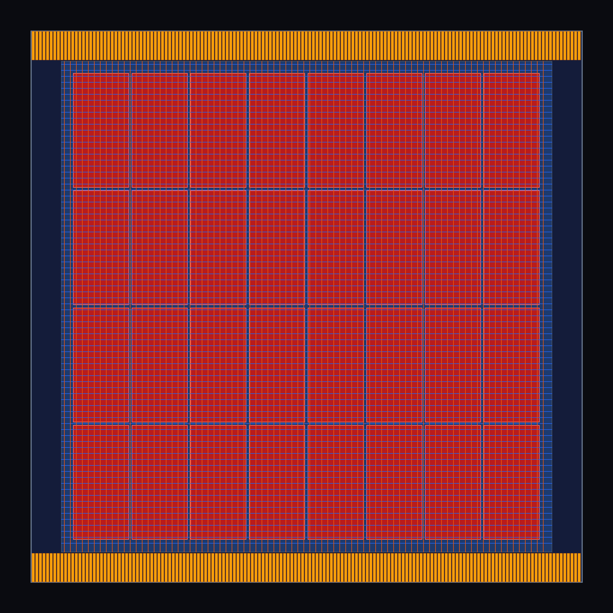
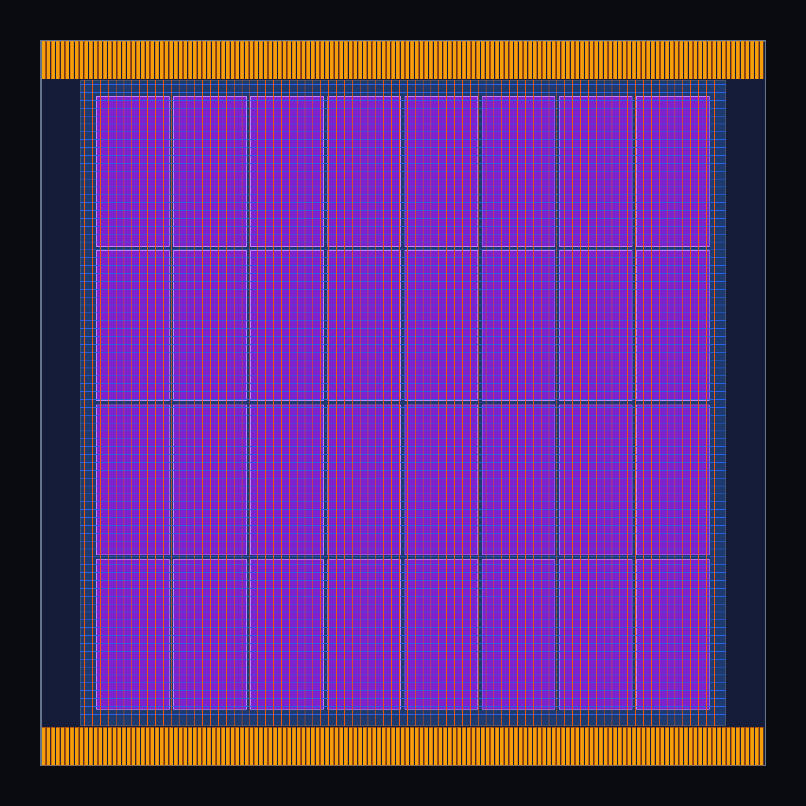
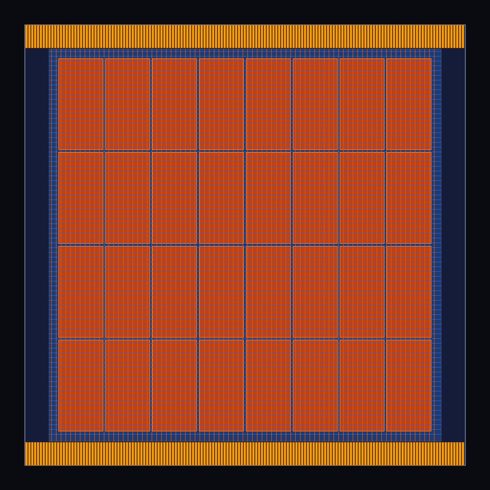
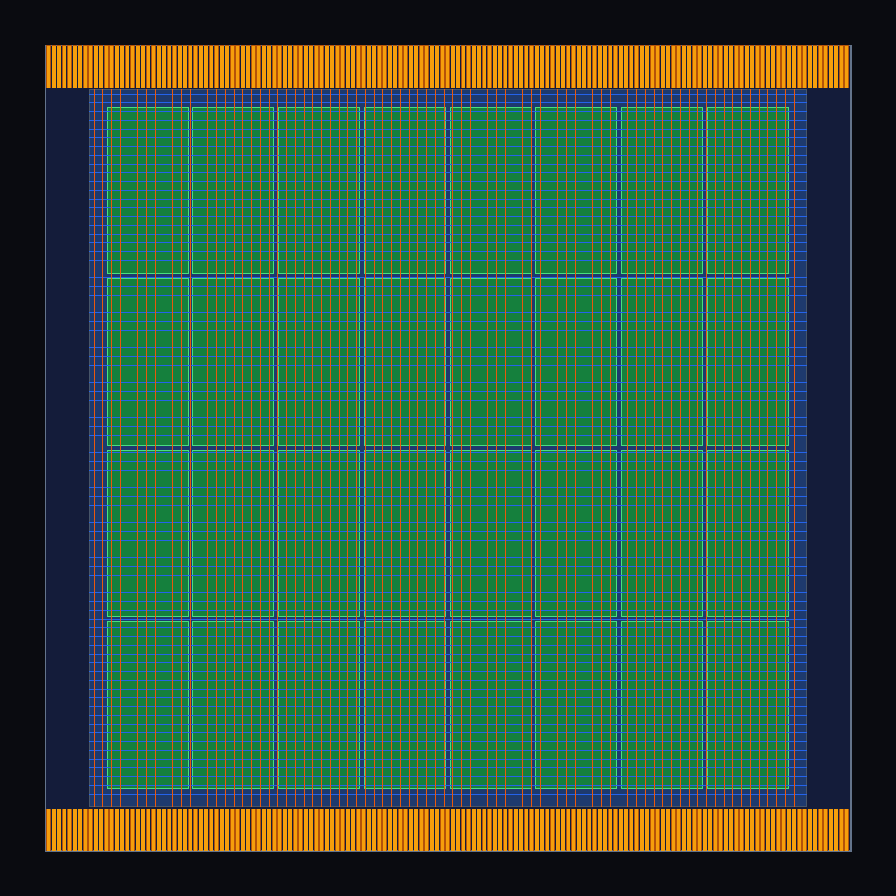

# GARUDA SEMESTA - 5-Chip Semiconductor Portfolio (Enterprise Monorepo Edition)

Portofolio 5 Raksasa Chip Semikonduktor (SoC, GPU, NPU, SECURE, MCU) & Ekosistem Perangkat Lunak (*Software SDK & AI Compilers*) mikroelektronika tingkat puncak (*ultimate hyperscale*) berbasis **BGA-6144 Socket Package**, **3D Mesh Torus Network-on-Chip (NoC)**, **Neuromorphic Spiking Neural Network (SNN) 32-Channel Array**, **Hardware Tensor Transformer Engine (GEMM AI Acceleration)**, **Hardware BVH Ray-Tracing Engine**, **CNN Systolic AI Vision Array**, **Quantum Entropy TRNG Vault**, **Ultra-Low-Power RISC-V IoT Array**, **Hexadeca-Channel DDR5 & HBM3e Memory Controller PHY (1024-bit Bus)**, **NVLink-5 Equivalent Link (1.8 TB/s)**, **GARUDA PyTorch AI Delegate**, **GARUDA ONNX Provider**, **GARUDA LLVM Driver**, **GARUDA NCCL Multi-Chip Comm**, **GARUDA TensorRT Optimizer**, **GARUDA Microkernel OS & OpenSBI Bootloader**, dan **Master CLI Suite (`garuda-cli`)**.

**Pembuat & Arsitek Sistem**: **Anggit Prasetyo Mituhu**

---

## 🔬 Portofolio 5 Chip & Masker Fisik Silikon (GDSII Lithography Masks)

Setiap chip dalam ekosistem **GARUDA SEMESTA** telah dilengkapi dengan berkas biner masker cetak silikon GDSII (`gds/*.gds`) dan render tata letak fisik 4K:

| # | Nama Chip & Spesifikasi Utama | Berkas Masker Fisik GDSII | Tata Letak Die Silikon 4K |
| :---: | :--- | :---: | :---: |
| **1** | **GARUDA CPU SoC v12.0** (32-Core SMP BGA-6144) | [`gds/garuda_cpu.gds`](gds/garuda_cpu.gds) |  |
| **2** | **GARUDA GPU v1.0 ULTIMATE** (64-Core Ray-Tracing) | [`gds/garuda_gpu.gds`](gds/garuda_gpu.gds) |  |
| **3** | **GARUDA NPU v1.0 ULTIMATE** (64-Engine AI Vision) | [`gds/garuda_npu.gds`](gds/garuda_npu.gds) |  |
| **4** | **GARUDA SECURE v1.0 ULTIMATE** (Crypto Vault) | [`gds/garuda_secure.gds`](gds/garuda_secure.gds) |  |
| **5** | **GARUDA MCU v1.0 ULTIMATE** (64-Core RISC-V IoT) | [`gds/garuda_mcu.gds`](gds/garuda_mcu.gds) |  |

---

## 🛡️ Dokumen Jaminan Mutu & Laporan Verifikasi Master

- 🌐 [`docs/GARUDA_5_Chip_Comprehensive_Audit.md`](docs/GARUDA_5_Chip_Comprehensive_Audit.md) *(Laporan Audit 5 Chip Lulus 100%)*
- 🌐 [`docs/GARUDA_5_Chip_Master_Docker_Report.md`](docs/GARUDA_5_Chip_Master_Docker_Report.md) *(Laporan Signoff Docker Master)*
- 🌐 [`docs/GARUDA_Silicon_Tapeout_Guarantee.md`](docs/GARUDA_Silicon_Tapeout_Guarantee.md) *(Dokumen Garansi Ready Tapeout)*
- 🌐 [`docs/GARUDA_NVIDIA_Grade_Certification_Report.md`](docs/GARUDA_NVIDIA_Grade_Certification_Report.md) *(Sertifikasi Tingkat NVIDIA B200)*

---

## 📄 Lisensi & Hak Cipta

Dipublikasikan di bawah **Apache License 2.0**.
Hak Cipta © 2026 **Anggit Prasetyo Mituhu**. Seluruh hak dilindungi undang-undang.
