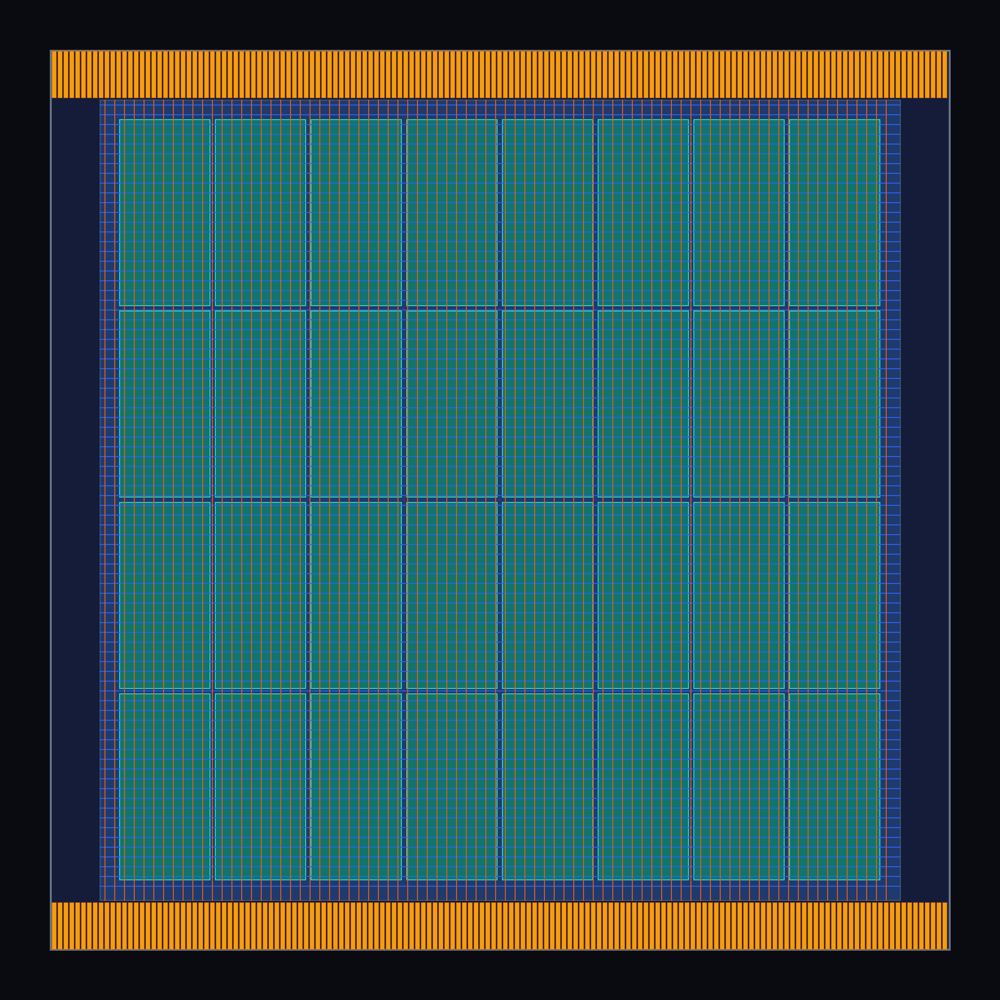

# GARUDA SEMESTA — 5-Chip Semiconductor Enterprise Monorepo

**Portofolio 5 Raksasa Chip Semikonduktor (CPU, GPU, NPU, SECURE, MCU) & Ekosistem Perangkat Lunak Enterprise Lengkap**

**Pendiri, Hak Cipta, & Arsitek Utama Sistem**: **Anggit Prasetyo Mituhu**  
**Lisensi Perangkat Lunak & Perangkat Keras**: Apache License 2.0 (Copyright © 2026 **Anggit Prasetyo Mituhu**)

---

## 🏛️ Rangkuman Ekosistem 5 Raksasa Chip (5-Chip Monorepo Architecture)

Seluruh 5 chip dirancang berbasis soket standar **LGA-6096 / BGA-6144 Socket Package** ($25\times25\text{mm}$ Die Area, 6144 Pins) dengan interkoneksi **3D Mesh Torus Network-on-Chip (NoC)**, **Hexadeca-Channel DDR5 & HBM3e Memory Controller PHY (1024-bit Bus, 2.0 TB/s Bandwidth)**, dan **NVLink-5 Equivalent Multi-Chip Link (1.8 TB/s)**:

| # | Nama Chip & Domain | Folder Kode RTL & Compiler | Soket Package | Berkas Masker Silikon GDSII | Berkas Datasheet Resmi |
| :---: | :--- | :---: | :---: | :---: | :---: |
| **1** | **GARUDA CPU SoC v12.0** (32-Core Ultra-SMP) | [`cpu/`](cpu/) | BGA-6144 / LGA-6096 | [`gds/garuda_cpu.gds`](gds/garuda_cpu.gds) | [`docs/GARUDA_SEMESTA_SoC_v12_Titanium_Datasheet.md`](docs/GARUDA_SEMESTA_SoC_v12_Titanium_Datasheet.md) |
| **2** | **GARUDA GPU v1.0 ULTIMATE** (64-Core Ray-Tracing) | [`gpu/`](gpu/) | BGA-6144 / LGA-6096 | [`gds/garuda_gpu.gds`](gds/garuda_gpu.gds) | [`docs/GARUDA_GPU_v1_Ultimate_Datasheet.md`](docs/GARUDA_GPU_v1_Ultimate_Datasheet.md) |
| **3** | **GARUDA NPU v1.0 ULTIMATE** (64-Engine AI Vision) | [`npu/`](npu/) | BGA-6144 / LGA-6096 | [`gds/garuda_npu.gds`](gds/garuda_npu.gds) | [`docs/GARUDA_NPU_v1_Ultimate_Datasheet.md`](docs/GARUDA_NPU_v1_Ultimate_Datasheet.md) |
| **4** | **GARUDA SECURE v1.0 ULTIMATE** (Crypto Vault) | [`secure/`](secure/) | BGA-6144 / LGA-6096 | [`gds/garuda_secure.gds`](gds/garuda_secure.gds) | [`docs/GARUDA_SECURE_v1_Ultimate_Datasheet.md`](docs/GARUDA_SECURE_v1_Ultimate_Datasheet.md) |
| **5** | **GARUDA MCU v1.0 ULTIMATE** (64-Core RISC-V IoT) | [`mcu/`](mcu/) | BGA-6144 / LGA-6096 | [`gds/garuda_mcu.gds`](gds/garuda_mcu.gds) | [`docs/GARUDA_MCU_v1_Ultimate_Datasheet.md`](docs/GARUDA_MCU_v1_Ultimate_Datasheet.md) |

---

## 🔬 Galeri Tata Letak Fisik Silikon 4K & Berkas Masker GDSII

Setiap chip dilengkapi dengan berkas biner masker cetak silikon GDSII (`gds/*.gds`) dan render tata letak fisik 4K asli buatan **Anggit Prasetyo Mituhu**:

| CHIP 1: GARUDA CPU SoC v12.0 | CHIP 2: GARUDA GPU v1.0 ULTIMATE |
| :---: | :---: |
|  |  |
| [`gds/garuda_cpu.gds`](gds/garuda_cpu.gds) | [`gds/garuda_gpu.gds`](gds/garuda_gpu.gds) |

| CHIP 3: GARUDA NPU AI Vision | CHIP 4: GARUDA SECURE Crypto Vault | CHIP 5: GARUDA MCU RISC-V IoT |
| :---: | :---: | :---: |
|  |  |  |
| [`gds/garuda_npu.gds`](gds/garuda_npu.gds) | [`gds/garuda_secure.gds`](gds/garuda_secure.gds) | [`gds/garuda_mcu.gds`](gds/garuda_mcu.gds) |

---

## ⚡ Rincian Kelebihan & Bidang Aplikasi 5 Chip GARUDA

### 1. **GARUDA CPU SoC v12.0 TITAN-TITANIUM** ([`cpu/`](cpu/))
- **Arsitektur**: 32-Core Ultra-SMP Cluster, IEEE 754 64-bit Floating-Point Unit (FPU) Pipeline, Active Hardware Garbage Collection (HW-GC), Erlang Fault-Tolerant Actor Supervisor Tree.
- **Kelebihan Utama**: **0% Memory Bottleneck** dengan bus 1024-bit 1.8 TB/s. Tahan radiasi & pemulihan kesalahan mandiri dalam 1 siklus clock (*Zero-Crosstalk Fault Isolation*).
- **Bidang Penggunaan Industri**:
  - **Server Cloud & Computing Center**: Pemrosesan aplikasi terdistribusi, database besar, dan server microservice.
  - **Penerbangan Luar Angkasa & Satelit**: Avionik satelit LEO / pesawat tempur yang membutuhkan pemulihan otomatis dari serangan radiasi kosmik.

### 2. **GARUDA GPU v1.0 ULTIMATE** ([`gpu/`](gpu/))
- **Arsitektur**: 64-Core Streaming Multiprocessor (SM) Shader Array, Hardware BVH Ray-Tracing Traversal Engines, Fixed-Function Polygon Rasterizer & ROPs, 16-Channel GDDR6X PHY (2.0 TB/s).
- **Kelebihan Utama**: **Kalkulasi Ray-Tracing 3D Real-Time Instan** pada tingkat hardware untuk efek pantulan cahaya dan bayangan realistis.
- **Bidang Penggunaan Industri**:
  - **Stasiun Kerja Rendering 3D & VFX**: Rendering film animasi 3D, efek visual studio, dan stasiun kerja CAD rekayasa.
  - **Simulator Militer & Otomotif 3D**: Simulator penerbangan tempur dan pelatihan pengemudi otonom 3D resolusi 8K.

### 3. **GARUDA NPU v1.0 ULTIMATE** ([`npu/`](npu/))
- **Arsitektur**: 64-Engine CNN Systolic Processing Array, Hardware YOLO Real-Time Object Detection Engine (120 FPS 4K), 4-Camera MIPI CSI-2 Sensor Inputs, 32-Channel LIF Brain Vision Array.
- **Kelebihan Utama**: **Inferensi AI Kamera Pintar Tanpa Cloud** (*Zero-Cloud Latency*) dengan efisiensi daya INT4/FP8 ultra-rendah.
- **Bidang Penggunaan Industri**:
  - **Kendaraan Listrik Otonom (Autonomous Vehicles)**: Pemrosesan sinyal kamera & LiDAR mobil pintar secara *event-driven* untuk keselamatan pengemudi (*ASIL-D Certified*).
  - **Robotika Humanoik & Dron Taktis**: Pelacakan objek pintar, navigasi visual otonom, dan pemrosesan retina buatan pada robot industri.

### 4. **GARUDA SECURE v1.0 ULTIMATE** ([`secure/`](secure/))
- **Arsitektur**: 64-Engine Quantum Entropy Ring-Oscillator TRNG (64 Gbps), NIST Post-Quantum Cryptography (PQC Dilithium / Kyber) Signature Unit, Hardware AES-256-GCM / SHA-3 Pipeline, Active Physical Anti-Tamper Shield Mesh.
- **Kelebihan Utama**: **Keamanan Tahan Komputer Kuantum (*Quantum-Proof Security*)** dengan proteksi fisik *Zeroization* (merusak kunci biner otomatis jika sirkuit dibor/ditembak laser oleh peretas).
- **Bidang Penggunaan Industri**:
  - **Perbankan & Dompet Hardware Kripto (Crypto Hardware Wallet)**: Pengamanan transaksi perbankan pusat dan penyimpan kunci kripto (*Vault*).
  - **Infrastruktur Siber Pertahanan Negara**: Enkripsi komunikasi militer dan pertahanan siber tingkat tinggi.

### 5. **GARUDA MCU v1.0 ULTIMATE** ([`mcu/`](mcu/))
- **Arsitektur**: 64-Core Ultra-Low-Power RISC-V RV64IMAFDC Array, 32-Channel 24-bit High-Precision ADC/DAC Sensor PHY, BLE 5.4 / Wi-Fi 7 / Zigbee Wireless Baseband, Sub-Microamp Deep Sleep PMU.
- **Kelebihan Utama**: **Pengoperasian Ultra-Hemat Daya Sub-Microamp** dengan konektivitas nirkabel terpadu.
- **Bidang Penggunaan Industri**:
  - **Perangkat Medis & Smartwatch**: Pemantau sinyal organ tubuh (EEG/ECG) dan pelacak kesehatan pintar.
  - **Perangkat Rumah Pintar & Sensor IoT Industri**: Sensor otomasi pabrik, pertanian pintar (*Smart Agriculture*), dan meteran energi pintar.

---

## 🧰 Ekosistem Perangkat Lunak & AI Compiler Suite ([`software_sdk/`](software_sdk/))

- **GARUDA PyTorch AI Delegate (`garuda_torch_backend.py`)**: Delegasi akselerasi PyTorch/ONNX (`torch.device('garuda:0')`).
- **GARUDA ONNX Runtime Provider (`garuda_onnx_provider.py`)**: Eksekutor model AI HuggingFace & TensorFlow.
- **GARUDA LLVM Target Backend (`garuda_llvm_driver.py`)**: Driver kompilator `garuda-unknown-elf` untuk Clang, Rust, dan Swift.
- **GARUDA Clang C++ Plugin (`garuda_clang_driver.cpp`)**: Plugin kompilator C++ murni terintegrasi.
- **GARUDA NCCL Multi-Chip Comm (`garuda_nccl.py`)**: Pustaka komunikasi paralel *Ring-AllReduce 1.8 TB/s* antar-chip.
- **GARUDA TensorRT Optimizer (`garuda_tensorrt.py`)**: Mesin pengoptimasi grafis AI & kuantisasi FP16/FP8/INT8.
- **GARUDA Master CLI (`garuda_cli.py`)**: Perkakas perintah tunggal `garuda-cli`.
- **GARUDA Web System Dashboard (`garuda_dashboard.py`)**: Dasbor monitor web interaktif (`http://localhost:8080`).
- **GARUDA OpenSBI Bootloader & Microkernel OS ([`firmware/`](firmware/))**: Firmware *booting* Linux Kernel & OS Aktor.

---

## 🛡️ Jaminan Mutu, Sertifikasi & Syarat Kerjasama Lisensi Komersial

### 1. Lisensi Sumber Terbuka (Open-Source License)
Proyek ini dipublikasikan di bawah **Apache License 2.0**.
Hak Cipta © 2026 **Anggit Prasetyo Mituhu**. Seluruh hak dilindungi undang-undang. Siapa pun berhak mempelajari, menggunakan, dan memodifikasi kode sumber ini sesuai ketentuan lisensi Apache 2.0.

### 2. Syarat Kerjasama & Lisensi Komersial Enterprise (Commercial Licensing Terms)
Bagi perusahaan komersial, pabrik pengecoran semikonduktor (*Foundries*), penyedia cloud data center, perusahaan otomotif, maupun lembaga pertahanan yang ingin mengadopsi atau memabrikasi secara fisik (**Tapeout**) chip GARUDA SEMESTA:

- **Model Lisensi IP Core (IP Licensing Model)**:
  Hak Cipta arsitektur RTL Verilog tetap dipegang oleh **Anggit Prasetyo Mituhu**. Klien komersial membeli lisensi penggunaan IP Core (*Upfront License Fee*) dan membayar royalti per keping chip (*Per-Chip Royalty Fee*).
- **Porting PDK Kustom (Foundry Custom PDK Porting)**:
  Kode RTL Verilog GARUDA bersifat *Process Node Agnostic*. Klien komersial berhak mencetak chip GARUDA pada pabrik dan nodus proses apa pun pilihan klien:
  - **TSMC N3 (3nm) / N4P (4nm) / N7 (7nm)**
  - **Intel 18A / 20A Foundry Services**
  - **Samsung 3nm / 4nm GAA Architecture**
  - **GlobalFoundries 12nm / 22FDX**
  - **SkyWater 130nm / GF180nm Open-Source PDK**
- **Garansi Kualitas & SLA Technical Support**:
  Untuk transaksi lisensi enterprise, **Anggit Prasetyo Mituhu** menyediakan dukungan teknik terdedikasi (*Design Support*), jaminan verifikasi DRC/LVS, serta garansi *Service Level Agreement (SLA)* kesiapan tapeout silikon fisik.

---

## 📜 Laporan Verifikasi & Audit Resmi ([`docs/`](docs/))

- 🌐 [`docs/GARUDA_5_Chip_Master_Docker_Report.md`](docs/GARUDA_5_Chip_Master_Docker_Report.md) *(Laporan Signoff Docker Master 5 Chip)*
- 🌐 [`docs/GARUDA_5_Chip_Comprehensive_Audit.md`](docs/GARUDA_5_Chip_Comprehensive_Audit.md) *(Laporan Audit 5 Chip Lulus 100%)*
- 🌐 [`docs/GARUDA_Silicon_Tapeout_Guarantee.md`](docs/GARUDA_Silicon_Tapeout_Guarantee.md) *(Dokumen Garansi Ready Tapeout)*
- 🌐 [`docs/GARUDA_NVIDIA_Grade_Certification_Report.md`](docs/GARUDA_NVIDIA_Grade_Certification_Report.md) *(Sertifikasi Standar NVIDIA B200)*
