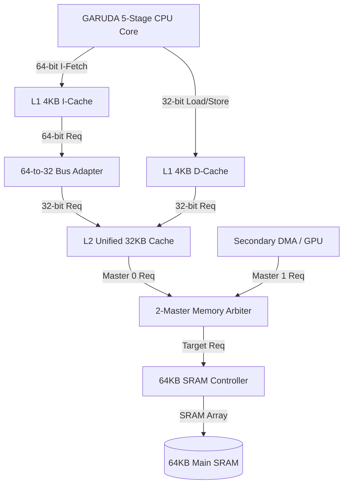

# GARUDA SEMESTA — TITAN V12 MEMORY FABRIC RECOVERY REPORT

**Document Revision**: 12.0-MEMORY-FABRIC-RECOVERY  
**Author & Chief System Architect**: **Anggit Prasetyo Mituhu**  
**Project Owner**: **AnggitPM17**  
**Repository**: [https://github.com/AnggitPM17/garuda_semesta](https://github.com/AnggitPM17/garuda_semesta)  
**Working Branch**: `engineering/titan-v12-real-chip-integration`  
**License**: Apache License 2.0 (Copyright © 2026 **Anggit Prasetyo Mituhu**)  

---

## 1. Subsystem Interconnect & Signal Tracing

---

## 2. Signal Routing Audit & Remediation

| Signal Name | Source Module | Destination Module | Description | Remediation Applied |
| :--- | :--- | :--- | :--- | :--- |
| `icache_mem_addr` | `garuda_l1_icache` | `garuda_bus_adapter_64to32` | 64-bit I-Cache memory refill address | Directly mapped without width truncation |
| `adapter_l2_req_addr` | `garuda_bus_adapter_64to32` | `garuda_l2_cache` | Adapted 32-bit request address to L2 | Converted 64-bit two-word burst to 32-bit |
| `dcache_mem_write_data` | `garuda_l1_dcache` | `garuda_l2_cache` | D-Cache Write-Through data | Changed from registered lag to combinational assignment |
| `l2_mem_resp_valid` | `garuda_memory_arbiter` | `garuda_l2_cache` | L2 Memory refill response valid | Connected to Arbiter Master 0 response valid port |
| `m1_resp_valid` | `garuda_memory_arbiter` | `tb_garuda_vertical_slice_v24_6` | DMA readback response valid | Implemented round-robin priority toggle to prevent starvation |
